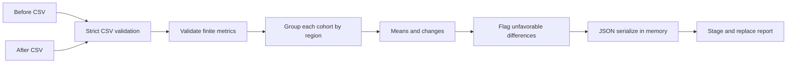

# PatchPulse — Engineering case study

**Problem space:** Reproducible, region-scoped comparisons of pre/post-update game telemetry  
**Implementation:** Python standard-library CSV parsing, validation, deterministic cohort analysis, and JSON reporting

[Repository](../README.md) · [Sample report](../evidence/sample-report.json) · [Before](../examples/before.csv) · [After](../examples/after.csv) · [Validation results](../evidence/validation.md)

## Problem and scope

Software-update regressions are easy to overstate: a lower average frame rate or higher ping in two observational datasets can reflect configuration, sampling differences, or conditions unrelated to the update. PatchPulse gives an engineer a simple **screening report** for further investigation. It does not provide statistical significance, randomized cohorts, or proof of a regression's cause.

This project uses six fictional CSV rows in its committed example; no real game service, telemetry API, or player data is accessed.

## Architecture

[`core.load_rows`](../src/patchpulse/core.py) validates an exact seven-column header, source rows, unique match IDs, nonnegative finite metrics, and integer crash counts. It retains region and numeric metrics for analysis, excluding match IDs from output.

[`core.analyze`](../src/patchpulse/core.py) validates direct Python callers separately from the CSV parser. It forms per-region cohorts, computes means and changes, enforces sample sufficiency, and reports understandable descriptive flags.

[`__main__.py`](../src/patchpulse/__main__.py) handles CLI arguments, rejects destination paths that alias either source, serializes the report before file writes, and stages output beside the target for safe replacement.

## Engineering decisions

**Make thresholds explicit.** By default, a negative FPS change of at least 10%, or an increase of at least 10% in frame time, ping, or crashes, is flagged only with a minimum of three observations on each side. Unchanged values do not produce flags at a zero threshold.

**Address the zero-baseline trap.** Percentage change cannot be defined when the baseline is zero. In the committed fixture, crashes move from **0** to **1/3 per session**; the original implementation produced `change_pct: null` and `regression: false` despite a positive increase. This upgrade retains `change_pct: null` and uses a **documented conservative investigation flag** for a zero-to-positive unfavorable metric when sample sufficiency is satisfied. No statistical conclusion is implied.

**Reject malformed or numerically unsafe inputs.** An input threshold of `NaN` or infinity must not disable checks or appear in output. The core rejects direct API values that are strings, booleans, non-finite numbers, fractional crash counts or extremely large, imprecise counts. It also rejects overflow in derived means and percentages.

**Prevent accidental data loss.** The CLI checks input/output aliasing—including existing hard links to either source—and stages a complete JSON document next to the destination. Invalid input does not truncate prior reports. This protects ordinary single-process workflows but does not coordinate concurrent writers or guarantee power-loss recovery.

## Evidence and reproducibility

The fictional [before cohort](../examples/before.csv) contains three sessions at build `1.0`; the [after cohort](../examples/after.csv) contains three at build `1.1`. All are labeled region `NA`.

| Measure | Before | After | Relative change |
| --- | ---: | ---: | ---: |
| Average FPS | 120.00 | 92.67 | −22.78% |
| p95 frame time, ms | 10.33 | 15.00 | +45.16% |
| p95 ping, ms | 31.00 | 36.00 | +16.13% |
| Crash count per session | 0.00 | 0.33 | Undefined (zero baseline) |

The **golden JSON file** in [`evidence/sample-report.json`](../evidence/sample-report.json) is checked for parsed structural equality in both the unit suite and real CLI subprocess regression tests, including the zero-baseline flag.

The original repository had three Python unit tests and Ubuntu CI on versions 3.10–3.12. The upgrade adds numeric boundary coverage, strict parsing, negative error paths, output protection, golden fixtures and a six-job Windows/Ubuntu matrix. See [verified CI status](../evidence/validation.md); a configured workflow is not itself proof of success.

## Complexity and tradeoffs

For `n` total rows and `r` regions, parsing and grouping costs **O(n)** time and storage. Each metric is aggregated once per region, then regions are sorted for reproducibility, giving **O(n + r log r)** analysis time and **O(n + r)** memory for the accepted rows and report.

The method deliberately reports simple means. It does not estimate confidence intervals, deduplicate repeated players, enforce build purity or match sessions across different cohorts. Grouping by region alone does not control the environments in which sessions were observed. For stronger evidence, future iterations could add controlled comparisons, uncertainty estimates, additional cohort dimensions and larger clearly sourced datasets.

## Interview-ready summary

> I built PatchPulse as a small offline diagnostic tool to compare synthetic before/after game telemetry by region. It validates CSV inputs, computes averages and directional changes, then reports investigation flags without claiming that a patch caused them. I fixed a missing edge case where crashes rose from a zero baseline but the report silently treated the undefined percentage as no regression. I also added strict numeric validation, explicit sample sufficiency, input/output overwrite protection, and tests that compare the actual CLI report against a committed JSON fixture. I verified the tests across Python versions and operating systems with GitHub Actions.
